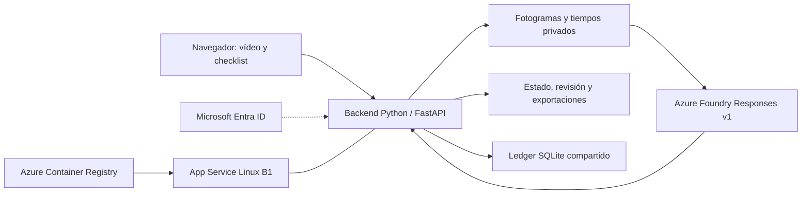

# Vídeo de un procedimiento a checklist con evidencia

Aplicación web en español para revisar una grabación breve de un procedimiento manual. Muestra los pasos junto al reproductor, permite saltar al intervalo de cada evidencia y guarda una revisión humana separada del análisis de IA. El resultado puede descargarse como HTML y JSON.

Una persona que prepara formación puede usarla para localizar acciones, revisar dudas y contrastar el orden que aparece en el vídeo. La demostración utiliza una cuerda y una anilla. La aplicación analiza la grabación; no certifica la seguridad del nudo ni lo ocurrido fuera de cámara.

## Qué puedes probar

1. Cargar el MP4 de ejemplo o subir uno de hasta 90 segundos y 25 MiB, en H.264.
2. Previsualizarlo e iniciar el análisis con estados de progreso.
3. Consultar la checklist y pulsar una evidencia para navegar por el vídeo.
4. Guardar una valoración propia sin reemplazar la salida de IA.
5. Descargar HTML y JSON y recuperar el mismo trabajo al recargar.

Los archivos corruptos, incompatibles o excesivos se rechazan antes de enviarse a Azure. El modo de integración real utiliza cuatro pasos congelados, S1 a S4. La edición libre de tres a seis pasos corresponde a la demostración sintética.

## Arquitectura

La integración real usa Azure Foundry Responses v1. El backend Python extrae fotogramas privados con sus tiempos, envía una solicitud al modelo y consulta el identificador de esa operación para recuperar el resultado. No vuelve a enviar el análisis por recargar la página.

La configuración comprobada el **15 de octubre de 2026** utilizó `gpt-6.1-sol`, versión `2026-09-29`, sobre una cuenta de IA en Sweden Central. Un contenedor con Python y FFmpeg se alojó en App Service Linux B1, West Europe; Azure Container Registry almacenaba su imagen en Sweden Central. El host utilizaba identidad administrada de Microsoft Entra y persistencia en `/home` para estado y ledger SQLite. El acceso a la aplicación y al relay HTTPS del ledger estaba restringido a la red del propietario.



El backend puede ejecutarse localmente. La prueba independiente recorrió su interfaz local contra Azure real y el relay alojado; del host remoto comprobó salud y commit. La disponibilidad actual de aquel despliegue no se ha verificado. Para reproducir la integración necesitas recursos y configuración propios vigentes.

## Inicio rápido: demostración sintética sin Azure

Requisitos: macOS o Linux, [uv](https://docs.astral.sh/uv/getting-started/installation/), Python **3.14.6** y FFmpeg/FFprobe con soporte H.264/libx264. El archivo `.python-version` fija Python y `uv.lock` fija las dependencias. uv puede descargar el intérprete si falta.

Descarga o clona la distribución de este código y abre la carpeta que contiene `pyproject.toml`. Ejecuta:

```sh
uv sync --frozen
uv run --frozen python scripts/prepare_media.py --inspect
uv run --frozen --env-file .env.example uvicorn video_checklist.main:app --host 127.0.0.1 --port 8765
```

Abre **http://127.0.0.1:8765**. Pulsa **Cargar vídeo de ejemplo**, **Analizar vídeo**, revisa un intervalo y guarda tus notas. Descarga los informes, abre el HTML y recarga la aplicación para comprobar la recuperación del trabajo.

Este modo genera **resultados sintéticos**. No llama a Azure ni genera cargos de análisis en Azure. Sus eventos ilustran el recorrido y no describen un vídeo propio que subas. La preparación inicial descarga una grabación pública de unos 191 MB si falta y crea los clips fuera del repositorio. Requiere red para esa descarga. Consulta [datos y licencia](docs/data.md).

## Ejecutar el análisis real en Azure

La demostración sintética funciona sin credenciales. El modo Azure requiere configuración privada de tu entorno, una identidad autorizada y un ledger compartido con límites e intentos vigentes. Las autorizaciones y recursos del ensayo de octubre no se transfieren a otros usuarios ni permiten repetirlo ahora.

1. Revisa [el preflight Azure](docs/azure-preflight.md), [el despliegue](docs/deploy-hosting.md) y [el control de consumo](docs/analysis-budget.md).
2. Prepara tu endpoint, modelo/deployment compatible, región y permisos Entra. Verifica que la configuración del esquema, identidad y commit coincida con tu autorización. Utiliza la ruta `azure_foundry_responses`; la ruta Content Understanding del código conserva un baseline histórico.
3. Guarda la configuración privada fuera de Git. `.env.example` enumera las variables; no contiene permiso ni credenciales para el análisis real. El entorno de Azure necesita su propio archivo, distinto del utilizado por la demostración sintética.
4. Configura el runtime privado y el mismo ledger canónico para todos los procesos que compartan el consumo. No copies ni reinicies un saldo para continuar una ejecución.
5. Inicia la aplicación con ese archivo privado:

```sh
uv run --frozen --env-file /ruta/privada/azure.env uvicorn video_checklist.main:app --host 127.0.0.1 --port 8765
```

Si la ruta al archivo contiene espacios, el ensayo documentó un problema con `uv --env-file`. Puedes cargar un archivo de entorno de confianza en un subshell y usar `--no-env-file`, como describe el preflight. La configuración privada y los tokens permanecen en el backend.

Las nuevas llamadas pueden generar cargos. Comprueba disponibilidad, precios, permisos y alcance de retirada antes de usarlas. Si un envío queda incierto, conserva su identificador y consulta la misma operación antes de considerar otro análisis.

## Código y comprobaciones

| Área | Archivos |
|---|---|
| Interfaz | `video_checklist/static/index.html`, `app.js`, `styles.css` |
| Backend HTTP | `video_checklist/main.py` |
| Cliente Responses | `video_checklist/foundry.py` |
| Vídeo y fotogramas | `video_checklist/media.py` |
| Estado y consumo | `video_checklist/store.py`, `ledger.py` |
| Informes | `video_checklist/export.py` |

```sh
uv run --frozen pytest -q
node --check video_checklist/static/app.js
uv lock --check
```

El segundo comando requiere Node.js. Las pruebas locales usan fixtures y transporte simulado; no sustituyen un recorrido real contra Azure.

La evidencia independiente aceptó la revisión 5, commit original `8ac4dd4a1a73ee9ba6fb0d4d46eb960998f50249`, con 197 pruebas y 26 subpruebas locales, además de tres análisis Azure nuevos. La edición para distribución puede sanear documentación y ejemplos; ese saneamiento no constituye una nueva validación de Azure.

## Resultados y límites

En tres variantes de una sola grabación hubo **11 eventos emparejados**, sin falsos positivos ni omisiones entre los eventos evaluados. Se comprobaron los 12 saltos al tiempo guardado y seis informes descargados. El emparejamiento admitía ±3 segundos respecto a la anotación manual.

Son tres ediciones de una única fuente, no tres muestras independientes. El muestreo de hasta dos fotogramas por segundo, 49 imágenes y 1280 píxeles de lado máximo puede perder acciones breves. Los tiempos son `model_estimate`; comprobar su formato no prueba interpretación correcta. La aplicación conserva incertidumbres y separa la valoración humana. No se midió ahorro de tiempo ni se acredita precisión general o uso industrial.

El coste efectivo y la retirada seguían pendientes al cierre del ensayo. La reserva provisional del ledger no es una factura ni un límite de facturación de Azure. Los recursos que permanezcan desplegados pueden generar costes adicionales.

## Privacidad y licencia

Mantén vídeos, respuestas crudas, configuración y tokens fuera de Git y de los informes. La demo local escucha sólo en `127.0.0.1`. El alojamiento del ensayo era privado y no constituye una configuración multiusuario pública.

El vídeo original es [Tying off onto the middle of a rope, de Slashme (2021)](https://commons.wikimedia.org/w/index.php?title=File:Tying_off_onto_the_middle_of_a_rope.webm&oldid=1120719840), bajo [CC BY-SA 4.0](https://creativecommons.org/licenses/by-sa/4.0/). Los derivados usan los primeros 37 segundos, sin audio y convertidos a H.264/1280×720. La variante omitida elimina los primeros 13 segundos; la reordenada los intercambia con el tramo de 13 a 15 segundos. Conserva autor, fuente, licencia y cambios al distribuirlos, sin sugerir respaldo del autor.

El código tiene licencia MIT; consulta [LICENSE](LICENSE). La licencia del código no cambia la del vídeo y sus derivados.
