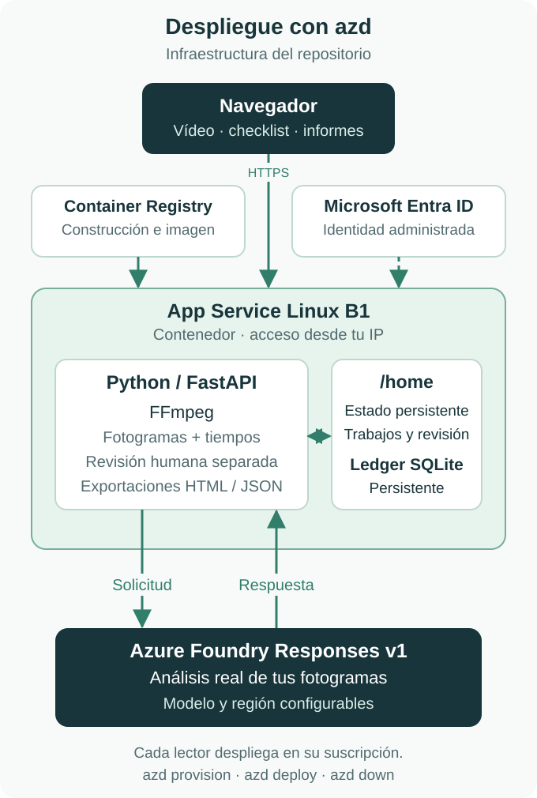

# Vídeo de un procedimiento a checklist con evidencia

Aplicación web en español para revisar una grabación breve de un procedimiento manual. Subes un vídeo propio, defines entre 3 y 6 pasos esperados y obtienes una checklist con las acciones que Azure identifica y sus intervalos. Cada evidencia permite saltar al momento del vídeo para comprobarla. Puedes guardar tu revisión por separado y descargar un informe HTML o JSON.

Sirve, por ejemplo, para revisar un vídeo de formación y localizar qué pasos se ven, cuáles requieren revisión y en qué orden aparecen. Una acción que no se observa en la grabación puede haber ocurrido fuera de cámara. El resultado necesita revisión humana y no certifica la seguridad ni la ejecución correcta del procedimiento.

## Desplegar en tu Azure

La aplicación realiza todos los análisis con Azure Foundry Responses. Necesitas tu propia suscripción Azure, cuota para el modelo y un vídeo real. El repositorio incluye la infraestructura y el despliegue con Azure Developer CLI (`azd`).

Instala [Azure Developer CLI](https://learn.microsoft.com/azure/developer/azure-developer-cli/install-azd) 1.34.2 o posterior y Git. Usa una cuenta con permisos para crear los recursos y sus asignaciones de roles en la suscripción elegida. La construcción de la imagen se hace en Azure Container Registry.

```sh
git clone https://github.com/sboludaf/azure-content-understanding-video-checklist-lab.git
cd azure-content-understanding-video-checklist-lab
azd auth login
azd env new video-checklist
azd env set AZURE_SUBSCRIPTION_ID "<tu-suscripcion>"
azd env set AZURE_LOCATION swedencentral
azd env set MVP_ALLOWED_CLIENT_CIDR "<tu-IP-publica>/32"
azd provision
azd deploy
```

Sustituye la suscripción y la IP. La restricción permite entrar a la aplicación únicamente desde esa IP; para IPv6 utiliza `/128`. Conserva el entorno local de `azd`, que identifica los recursos que has creado.

`azd provision` crea el grupo de recursos, Container Registry, App Service y la cuenta de IA con su deployment e identidad. `azd deploy` construye y publica el código en esos recursos. En las siguientes actualizaciones de código basta con `azd deploy`; si cambias la infraestructura, vuelve a ejecutar primero `azd provision`.

El modelo predeterminado es `gpt-6.1-sol`, versión `2026-09-29`, con SKU `GlobalStandard`. Comprueba su disponibilidad y cuota en tu cuenta antes de aprovisionar. Puedes configurar un modelo compatible con visión, Responses, ejecución en segundo plano y salida JSON Schema; cambiarlo requiere comprobar de nuevo los resultados. Los valores de región y modelo están en la [guía de Azure](docs/deploy-hosting.md).

## Usar la aplicación

Abre la dirección que muestra `azd deploy` y sigue este recorrido:

1. Sube tu MP4 H.264 de hasta 90 segundos y 25 MiB.
2. Escribe entre 3 y 6 pasos, con acciones concretas que puedan verse en la grabación.
3. Inicia el análisis. El backend valida el vídeo, extrae fotogramas y llama a tu deployment de Azure.
4. Revisa la checklist y pulsa los intervalos para comprobar la evidencia en el reproductor.
5. Guarda tu valoración y descarga HTML o JSON. Al recargar, la aplicación recupera el mismo trabajo.

El arranque y el despliegue no envían vídeos al modelo. Cada análisis que inicies puede generar cargos en tu suscripción. Los archivos corruptos, incompatibles o que exceden los límites se rechazan antes del envío.

## Arquitectura



App Service Linux B1 ejecuta un contenedor con FastAPI y FFmpeg. El backend extrae hasta 49 fotogramas, conserva sus tiempos y usa Azure Foundry Responses v1. Una identidad administrada de Microsoft Entra da al host acceso al modelo y a la imagen de Container Registry. Las credenciales permanecen en Azure.

Los vídeos, fotogramas, respuestas, revisiones y el ledger SQLite persisten en `/home/video-checklist`. La instalación usa una instancia y un proceso para conservar la coordinación de los análisis. Un identificador persistido permite recuperar la misma operación tras una recarga; recargar no inicia otra llamada de análisis.

## Costes, datos y retirada

App Service B1 y Container Registry Basic generan costes mientras existan. Se añaden el uso del modelo y los demás conceptos aplicables de Azure. Los límites de intentos y minutos del ledger no son un límite de facturación. Revisa precios y consumo en tu suscripción.

Los vídeos se envían como fotogramas a tu recurso Azure. La aplicación conserva los archivos y resultados en el almacenamiento persistente del host y no programa su borrado. Usa vídeos que puedas tratar en Azure y descarga los informes que necesites antes de retirar la instalación:

```sh
azd down
```

Confirma la eliminación de los recursos del entorno que te muestra `azd`. La retirada destruye los archivos guardados en el host. Consulta en la [guía](docs/deploy-hosting.md) la retención de respuestas del servicio.

## Código y comprobaciones

La interfaz está en `video_checklist/static/`; `main.py` expone la API; `foundry.py` integra Responses; `media.py` procesa el vídeo; `store.py` y `ledger.py` conservan estado y consumo; `export.py` genera informes. `azure.yaml`, `infra/` y los hooks describen el despliegue.

Para desarrollar y ejecutar las pruebas locales necesitas [uv](https://docs.astral.sh/uv/getting-started/installation/) y FFmpeg/FFprobe:

```sh
uv sync --frozen
MVP_RUNTIME_DIR=/tmp/video-checklist-tests uv run --frozen pytest -q
node --check video_checklist/static/app.js
uv lock --check
```

Node.js sólo es necesario para comprobar la sintaxis del JavaScript. Las pruebas usan dobles de transporte dentro de `tests/`, sin invocar Azure ni ofrecer un modo de análisis simulado en la aplicación. La comprobación completa requiere desplegar y recorrer la interfaz con un vídeo real.

La procedencia y el alcance de las pruebas históricas se explican en [SOURCE_REVISION.md](SOURCE_REVISION.md). La muestra de evaluación histórica usa una grabación real, con [atribución y licencia propias](docs/data.md). El código tiene licencia [MIT](LICENSE).
